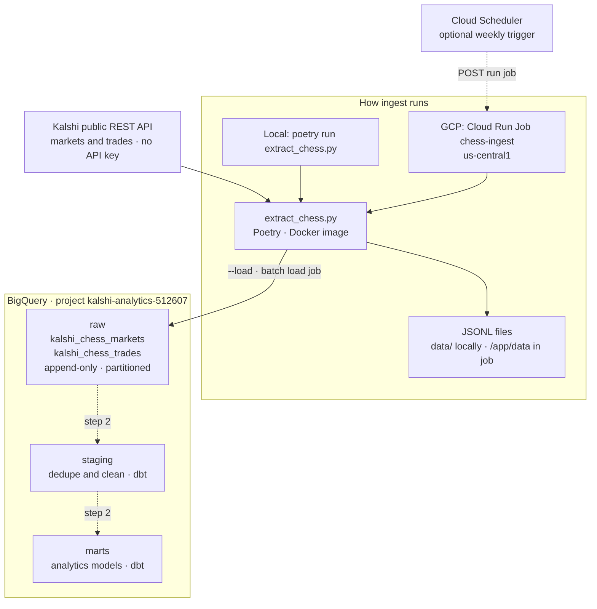
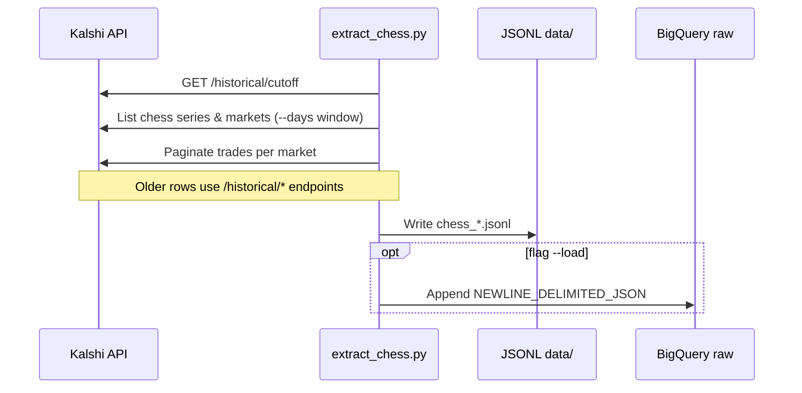

# Kalshi chess analytics — data ingest

This repository pulls **chess-related prediction markets and public trades** from [Kalshi’s public REST API](https://kalshi.com) and lands them in **Google BigQuery** for analysis. No Kalshi API key is required—the endpoints used here are public.

**Status:** Step 1 is **done** (ingest to BigQuery `raw`). **dbt** models and **Airflow on Composer** are planned next. See [plan.md](plan.md).

## Architecture overview

Solid boxes are **live today**. Dashed boxes and arrows are **planned** (step 2+).



| Layer | Role |
| --- | --- |
| **Kalshi API** | Source of chess markets and public trades ([live vs historical](api_history.md) routing inside the script). |
| **extract_chess.py** | Fetch, paginate, write JSONL; optionally append to BigQuery. |
| **Cloud Run Job** | Same script with `--load` in production; image from Artifact Registry via [deploy/cloud_run_ingest.sh](deploy/cloud_run_ingest.sh). |
| **raw** | Landing zone—API shape, `_ingested_at` lineage; overlaps OK until staging dedupes. |
| **staging / marts** | Not built yet—see [plan.md](plan.md). |

---

## What you get

| Piece | Description |
| --- | --- |
| **Markets** | Chess markets (Sports series with Chess tag, plus titles containing “chess”) with prices, volume, status, settlement fields, etc. |
| **Trades** | Public trade history for those markets (price, size, side, timestamps). |
| **Storage** | Append-only tables in BigQuery dataset **`raw`**, with `_ingested_at` on each row for lineage. |
| **Production** | Docker image on **Cloud Run Job** `chess-ingest` (`us-central1`), project **`kalshi-analytics-512607`**. |

**Medallion layout (BigQuery datasets):**

- **`raw`** — API-shaped snapshots (this repo loads here).
- **`staging`** — reserved for deduplicated, cleaned tables (future **dbt**).
- **`marts`** — reserved for analytics-ready models (future **dbt**).

**Tables written by ingest:**

- `raw.kalshi_chess_markets`
- `raw.kalshi_chess_trades`

`raw` is intentionally **not deduplicated**. Weekly runs with a 7-day window will append overlapping rows; dedupe belongs in `staging` later.

---

## How it works (high level)



1. **Discover** chess series and markets (default: markets whose `created_time` is in the last **7 days**; override with `--days`).
2. **Fetch trades** for those markets over the same time window.
3. **Route live vs historical** using Kalshi’s `/historical/cutoff` (older settled markets and trades use historical endpoints). Details: [api_history.md](api_history.md).
4. **Paginate** all list endpoints (page size 1000). Details: [api_pagination.md](api_pagination.md).
5. **Write** newline-delimited JSON locally, or **append** to BigQuery with a batch load job when you pass `--load`.

Retries: HTTP **429** only (exponential backoff). Other errors fail fast after `raise_for_status()`.

---

## Prerequisites

**Local extract (JSONL only)**

- [Poetry](https://python-poetry.org/docs/#installation)
- Python **3.11+**
- Network access to `external-api.kalshi.com`

**Local extract + BigQuery load (`--load`)**

- [Google Cloud SDK](https://cloud.google.com/sdk) (`gcloud`, `bq`)
- Application Default Credentials, e.g. `gcloud auth application-default login`
- Project set: `gcloud config set project kalshi-analytics-512607`
- BigQuery tables created once from [schema.sql](schema.sql) (see below)

**Deploy / run on GCP**

- Docker Desktop (for building **linux/amd64** images on Apple Silicon)
- Permission to push to Artifact Registry and update Cloud Run in `kalshi-analytics-512607`

---

## Quick start — local

```bash
poetry install

# Last 7 days → data/chess_*.jsonl (no GCP calls)
poetry run python extract_chess.py

# Shorter window while testing
poetry run python extract_chess.py --days 1

# Same extract, then append to BigQuery raw tables
poetry run python extract_chess.py --load
```

Output files live under **`data/`** (gitignored). Fixed-point API amounts stay **strings** in JSONL; BigQuery loads them as `NUMERIC` per [schema.sql](schema.sql).

---

## Quick start — BigQuery (one-time DDL)

Creates datasets `raw`, `staging`, `marts` and the two chess raw tables:

```bash
bq query --use_legacy_sql=false --project_id=kalshi-analytics-512607 < schema.sql
```

Check row counts after a load:

```bash
bq query --use_legacy_sql=false \
  'SELECT COUNT(*) FROM `kalshi-analytics-512607.raw.kalshi_chess_markets`'
```

Query tips (partitioning, clustering, append-only behavior): [bq_best_practices.md](bq_best_practices.md).

---

## Quick start — production (Cloud Run)

Full deploy steps, IAM, optional weekly **Cloud Scheduler**, and troubleshooting: **[deploy/README.md](deploy/README.md)**.

```bash
./deploy/cloud_run_ingest.sh
gcloud run jobs execute chess-ingest --region=us-central1 --wait
```

The job runs `extract_chess.py --load` inside the container. Service account: `chess-ingest@kalshi-analytics-512607.iam.gserviceaccount.com`.

---

## Repository map

| Path | Role |
| --- | --- |
| [extract_chess.py](extract_chess.py) | Main ingest: API → JSONL → optional BQ load |
| [schema.sql](schema.sql) | BigQuery datasets and `raw.kalshi_chess_*` DDL |
| [pyproject.toml](pyproject.toml) / [poetry.lock](poetry.lock) | Dependencies (`requests`, `google-cloud-bigquery`) |
| [Dockerfile](Dockerfile) | Image for Cloud Run Job |
| [deploy/cloud_run_ingest.sh](deploy/cloud_run_ingest.sh) | Build amd64, push, create/update job |
| [kalshi.py](kalshi.py) | Small smoke script against the API |
| [api_page_test.py](api_page_test.py) | Pagination smoke script |
| `data/` | Local JSONL output (not committed) |

---

## Roadmap

| Step | Goal | Status |
| --- | --- | --- |
| **1** | Containerized ingest → `raw.kalshi_chess_*` | **Complete** |
| **2** | dbt: `staging` + `marts` (dedupe, analytics SQL) | Planned |
| **3** | Composer DAG: ingest → dbt | Planned |

Full target stack (Composer, second dbt job): [plan.md](plan.md).

---

## Further reading

| Document | Contents |
| --- | --- |
| [plan.md](plan.md) | Roadmap and target architecture |
| [deploy/README.md](deploy/README.md) | Cloud Run, Artifact Registry, Scheduler, IAM |
| [bq_best_practices.md](bq_best_practices.md) | Medallion naming, partitions, dedupe strategy |
| [api_pagination.md](api_pagination.md) | Cursor pagination conventions |
| [api_history.md](api_history.md) | Live vs historical endpoints |
| [AGENTS.md](AGENTS.md) | Contributor / agent conventions for this repo |

---

## Security notes

- Do **not** commit `data/` or credential files.
- Kalshi: no API key in this project.
- GCP: local `--load` uses your user ADC; production uses the dedicated ingest service account.
