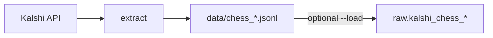

# Kalshi chess analytics — data ingest

This repository pulls **chess-related prediction markets and public trades** from [Kalshi’s public REST API](https://kalshi.com) and lands them in **Google BigQuery** for analysis. No Kalshi API key is required—the endpoints used here are public.

**Status:** Step 1 is **done** (ingest to BigQuery `raw`). **dbt** models and **Airflow on Composer** are planned next. See [plan.md](plan.md).

**Who is this for?**

- **[Browse the code](#code-tour)** — map of [extract_chess.py](extract_chess.py) and where to read next.
- **[Run locally (no GCP)](#quick-start)** — `poetry install` then `poetry run python extract_chess.py` (JSONL only).
- **[Load BigQuery / production](#quick-start)** — BigQuery DDL, `--load`, and [deploy/README.md](deploy/README.md) for Cloud Run.

## Architecture overview

Solid boxes are **live today**. Dashed boxes and arrows are **planned** (step 2+).

<p align="center">
  
</p>

| Layer | Role |
| --- | --- |
| **Kalshi API** | Source of chess markets and public trades ([live vs historical](api_history.md) routing inside the script). |
| **extract_chess.py** | Fetch, paginate, write JSONL; optionally append to BigQuery. |
| **Cloud Run Job** | Same script with `--load` in production; image from Artifact Registry via [deploy/cloud_run_ingest.sh](deploy/cloud_run_ingest.sh). |
| **raw** | Landing zone—API shape, `_ingested_at` lineage; overlaps OK until staging dedupes. |
| **staging / marts** | Not built yet—see [plan.md](plan.md). |

---

**Medallion layout (BigQuery datasets):**

- **`raw`** — API-shaped snapshots (this repo loads here).
- **`staging`** — reserved for deduplicated, cleaned tables (future **dbt**).
- **`marts`** — reserved for analytics-ready models (future **dbt**).

**Tables written by ingest:**

- `raw.kalshi_chess_markets`
- `raw.kalshi_chess_trades`

`raw` is intentionally **not deduplicated**. Weekly runs with a 7-day window will append overlapping rows; dedupe belongs in `staging` later.

---

## Code tour

Almost all ingest logic lives in a single module, [extract_chess.py](extract_chess.py). Read it in this order:

| Stage | Functions (starting points) | Read next |
| --- | --- | --- |
| HTTP + pagination | `get`, `paginate` | [api_pagination.md](api_pagination.md) |
| Chess scope | `list_chess_series` | Module docstring (series filter rules) |
| Live vs historical | `cutoff_unix`, `extract_markets`, `iter_trades` | [api_history.md](api_history.md) |
| Shaping + lineage | `transform_market`, `transform_trade` (`_source`, `_ingested_at`) | [schema.sql](schema.sql) |
| Orchestration | `extract` → `main` | [CLI & smoke checks](#cli--smoke-checks) |
| BigQuery load | `load_jsonl`, `load_to_bigquery` | `WRITE_APPEND` / `CREATE_NEVER` in code |

In-script control flow (GCP topology is in the diagram above):



---

## How it works (high level)

1. **Discover** chess series and markets (default: markets whose `created_time` is in the last **7 days**; override with `--days`).
2. **Fetch trades** for those markets over the same time window.
3. **Route live vs historical** using Kalshi’s `/historical/cutoff` (older settled markets and trades use historical endpoints). Details: [api_history.md](api_history.md).
4. **Paginate** all list endpoints (page size 1000). Details: [api_pagination.md](api_pagination.md).
5. **Write** newline-delimited JSON locally, or **append** to BigQuery with a batch load job when you pass `--load`.

Retries: HTTP **429** only (exponential backoff). Other errors fail fast after `raise_for_status()`.

---

## Quick start

Needs [Poetry](https://python-poetry.org/docs/#installation) (Python 3.11+). For `--load` or Cloud Run: [Google Cloud SDK](https://cloud.google.com/sdk), ADC (`gcloud auth application-default login`), and `gcloud config set project kalshi-analytics-512607`.

**1. BigQuery (once)** — datasets `raw` / `staging` / `marts` and `raw.kalshi_chess_*` tables:

```bash
bq query --use_legacy_sql=false --project_id=kalshi-analytics-512607 < schema.sql
```

**2. Extract locally** — last **7 days** (default) to gitignored `data/chess_*.jsonl`; use `--days N` to narrow. `--load` appends JSONL to `raw` (fixed-point fields stay strings in files, `NUMERIC` in BQ per [schema.sql](schema.sql)):

```bash
poetry install
poetry run python extract_chess.py           # API only, no GCP
poetry run python extract_chess.py --load    # extract + append to raw
```

**3. Production** — same script with `--load` on Cloud Run Job `chess-ingest` (`chess-ingest@kalshi-analytics-512607.iam.gserviceaccount.com`). Deploy, IAM, Scheduler, amd64 build: [deploy/README.md](deploy/README.md).

```bash
./deploy/cloud_run_ingest.sh
gcloud run jobs execute chess-ingest --region=us-central1 --wait
```

After a load, verify row counts in the BigQuery console or with `bq query` on `raw.kalshi_chess_markets`.

---

## CLI & smoke checks

| Flag | Default | Purpose |
| --- | --- | --- |
| `--days` | `7` | Market `created_time` lookback |
| `--load` | off | Append JSONL to `raw.kalshi_chess_*` |
| `--project` | `kalshi-analytics-512607` | BQ project when `--load` |

After you change API or pagination logic, run a narrow extract before `--load`:

```bash
poetry run python kalshi.py                    # quick API reachability
poetry run python api_page_test.py             # pagination smoke
poetry run python extract_chess.py --days 1    # narrow window before --load
```

Coding style, testing expectations, and commit notes: [AGENTS.md](AGENTS.md).

---

## Repository map

| Path | Role |
| --- | --- |
| [extract_chess.py](extract_chess.py) | Main ingest: API → JSONL → optional BQ load |
| [schema.sql](schema.sql) | BigQuery datasets and `raw.kalshi_chess_*` DDL |
| [pyproject.toml](pyproject.toml) / [poetry.lock](poetry.lock) | Dependencies (`requests`, `google-cloud-bigquery`) |
| [Dockerfile](Dockerfile) | Image for Cloud Run Job |
| [deploy/cloud_run_ingest.sh](deploy/cloud_run_ingest.sh) | Build amd64, push, create/update job |
| [kalshi.py](kalshi.py) | Small smoke script against the API |
| [api_page_test.py](api_page_test.py) | Pagination smoke script |
| `data/` | Local JSONL output (not committed) |

---

## Roadmap

| Step | Goal | Status |
| --- | --- | --- |
| **1** | Containerized ingest → `raw.kalshi_chess_*` | **Complete** |
| **2** | dbt: `staging` + `marts` (dedupe, analytics SQL) | Planned |
| **3** | Composer DAG: ingest → dbt | Planned |

Full target stack (Composer, second dbt job): [plan.md](plan.md).

---

## Further reading

| Document | Contents |
| --- | --- |
| [plan.md](plan.md) | Roadmap and target architecture |
| [deploy/README.md](deploy/README.md) | Cloud Run, Artifact Registry, Scheduler, IAM |
| [api_pagination.md](api_pagination.md) | Cursor pagination conventions |
| [api_history.md](api_history.md) | Live vs historical endpoints |
| [AGENTS.md](AGENTS.md) | Contributor / agent conventions for this repo |
