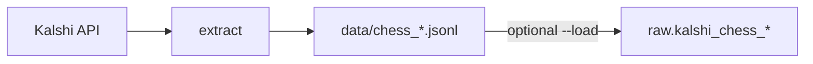

# Kalshi Chess Analytics

Pull **chess prediction markets and public trades** from [Kalshi's public API](https://kalshi.com) and load them into **Google BigQuery**. No Kalshi API key needed.

> **Status:** Step 1 (ingest to BigQuery `raw`) is done. Step 2 (**dbt**) is in progress: `staging` models dedupe markets and trades; `marts` are next. Composer orchestration comes after — see [plan.md](plan.md).

**Jump to:** [Quick start](#quick-start) · [dbt](#transform-with-dbt) · [How it works](#how-it-works) · [Options](#command-line-options) · [Code tour](#code-tour) · [Roadmap](#roadmap) · [More docs](#more-docs)

---

## Quick start

**You need:** [Poetry](https://python-poetry.org/docs/#installation) and Python 3.11+. Only for BigQuery loading or deploying: the [Google Cloud SDK](https://cloud.google.com/sdk).

### Option A — Try it locally (no Google Cloud)

```bash
poetry install
poetry run python extract_chess.py
```

This fetches the last 7 days of chess markets and trades and writes `data/chess_*.jsonl`.

### Option B — Load into BigQuery

```bash
# 1. Sign in and pick the project
gcloud auth application-default login
gcloud config set project kalshi-analytics-512607

# 2. Create datasets and tables (one time)
bq query --use_legacy_sql=false --project_id=kalshi-analytics-512607 < schema.sql

# 3. Extract and append to raw.kalshi_chess_*
poetry run python extract_chess.py --load
```

Check the result:

```sql
SELECT COUNT(*) FROM `kalshi-analytics-512607.raw.kalshi_chess_markets`;
```

### Option C — Run in production (Cloud Run Job)

```bash
./deploy/cloud_run_ingest.sh
gcloud run jobs execute chess-ingest --region=us-central1 --wait
```

Needs Docker running. Deploy details, IAM, Scheduler and troubleshooting: [deploy/README.md](deploy/README.md).

---

## Transform with dbt

After `raw` has data, dbt builds clean tables in `staging`. It uses **dbt-core** (installed by `poetry install`) and the same gcloud login as Option B, so no extra credentials.

```bash
cd dbt
poetry run dbt debug    # check the connection
poetry run dbt build    # run models and tests
```

Always use `poetry run dbt`, not a bare `dbt`: another dbt (Fusion) may be on your `PATH`.

| Model | Result |
| --- | --- |
| `stg_kalshi_chess_markets` | One row per market (`ticker`), newest snapshot wins |
| `stg_kalshi_chess_trades` | One row per trade (`trade_id`), newest snapshot wins |

Project layout and status: [dbt/README.md](dbt/README.md).

---

## Architecture

Solid boxes are **live today**; dashed ones are **planned**. (The image predates dbt: `staging` is now built, `marts` is not.)

<p align="center">
  
</p>

| Layer | What it does |
| --- | --- |
| **Kalshi API** | Source of chess markets and public trades |
| **`extract_chess.py`** | Fetches, paginates, writes JSONL, optionally appends to BigQuery |
| **Cloud Run Job** | Runs the same script with `--load` in production |
| **`raw`** | Landing zone, API-shaped, with `_ingested_at` lineage |
| **dbt (`dbt/`)** | Run by hand for now; builds `staging` from `raw` |
| **`staging`** | Deduplicated views: `stg_kalshi_chess_markets`, `stg_kalshi_chess_trades` |
| **`marts`** | Not built yet |

### BigQuery datasets and tables

| Dataset | Purpose | Status |
| --- | --- | --- |
| `raw` | API-shaped snapshots: `kalshi_chess_markets`, `kalshi_chess_trades` | Live |
| `staging` | Deduplicated views built by dbt | Live |
| `marts` | Analytics-ready models | Planned |

> **Heads-up:** `raw` is **not deduplicated**. Runs with overlapping windows append overlapping rows; always query `staging` for clean data.

---

## How it works

1. **Discover** chess series and markets created in the last `--days` (default 7).
2. **Fetch trades** for those markets over the same window.
3. **Route live vs historical** using Kalshi's `/historical/cutoff` ([details](api_history.md)).
4. **Paginate** every list endpoint, 1000 per page ([details](api_pagination.md)).
5. **Write** newline-delimited JSON, or with `--load` append it to BigQuery via a batch load job.

Only HTTP **429** is retried (exponential backoff); other errors fail fast.



---

## Command-line options

| Flag | Default | Purpose |
| --- | --- | --- |
| `--days N` | `7` | How far back to look at market `created_time` |
| `--load` | off | Append the JSONL output to `raw.kalshi_chess_*` |
| `--project ID` | `kalshi-analytics-512607` | BigQuery project used with `--load` |

**Before loading after a code change**, run the smoke checks:

```bash
poetry run python kalshi.py                    # is the API reachable?
poetry run python api_page_test.py             # does pagination work?
poetry run python extract_chess.py --days 1    # small extract first
```

---

## Code tour

Nearly all logic is in [extract_chess.py](extract_chess.py). Suggested reading order:

| Stage | Start with | Read next |
| --- | --- | --- |
| HTTP + pagination | `get`, `paginate` | [api_pagination.md](api_pagination.md) |
| Chess scope | `list_chess_series` | Module docstring |
| Live vs historical | `cutoff_unix`, `extract_markets`, `iter_trades` | [api_history.md](api_history.md) |
| Shaping + lineage | `transform_market`, `transform_trade` | [schema.sql](schema.sql) |
| Orchestration | `extract` → `main` | [Options](#command-line-options) |
| BigQuery load | `load_jsonl`, `load_to_bigquery` | `WRITE_APPEND` / `CREATE_NEVER` |

### Repository map

| Path | Role |
| --- | --- |
| [extract_chess.py](extract_chess.py) | Main ingest: API → JSONL → optional BigQuery |
| [schema.sql](schema.sql) | Datasets and `raw.kalshi_chess_*` DDL |
| [dbt/](dbt/README.md) | dbt project: sources, `staging` models, tests |
| [pyproject.toml](pyproject.toml), [poetry.lock](poetry.lock) | Dependencies (dbt in the `dev` group) |
| [Dockerfile](Dockerfile) | Cloud Run Job image |
| [deploy/](deploy/) | Build, push and create/update the job |
| [kalshi.py](kalshi.py), [api_page_test.py](api_page_test.py) | Smoke scripts |
| `data/` | Local JSONL output (not committed) |

---

## Roadmap

| Step | Goal | Status |
| --- | --- | --- |
| 1 | Containerized ingest → `raw.kalshi_chess_*` | ✅ Complete |
| 2 | dbt: `staging` (dedupe) + `marts` (analytics SQL) | 🚧 In progress: staging done, marts next |
| 3 | Composer DAG: ingest → dbt | Planned |

---

## More docs

| Document | Contents |
| --- | --- |
| [plan.md](plan.md) | Roadmap and target architecture |
| [dbt/README.md](dbt/README.md) | dbt project layout, commands, status |
| [deploy/README.md](deploy/README.md) | Cloud Run, Artifact Registry, Scheduler, IAM |
| [api_pagination.md](api_pagination.md) | Cursor pagination |
| [api_history.md](api_history.md) | Live vs historical endpoints |
| [AGENTS.md](AGENTS.md) | Contributor and agent conventions |
