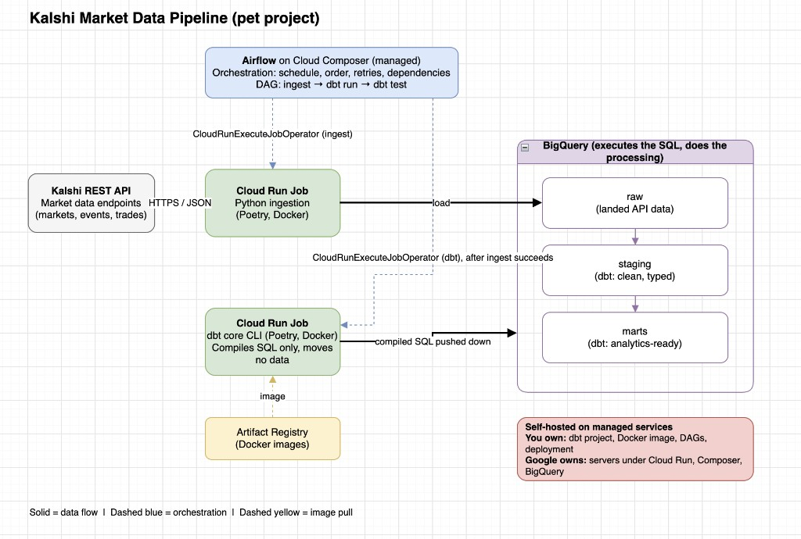

# Kalshi analytics — roadmap

## Step 1 — Containerized ingest to BigQuery `raw` (complete)

Land Kalshi chess API data in BigQuery. Production path: **Cloud Run Job** `chess-ingest` in `us-central1` → **`raw.kalshi_chess_markets`** / **`raw.kalshi_chess_trades`**. dbt and Composer are **step 2+**.

| Substep | What | Status |
| --- | --- | --- |
| **1a. Raw dataset** | Datasets `raw` / `staging` / `marts` via [schema.sql](schema.sql); ingest tables `raw.kalshi_chess_*` | Done (DDL applied) |
| **1b. Poetry** | [pyproject.toml](pyproject.toml) (`package-mode = false`) | Done |
| **1c. Docker** | [Dockerfile](Dockerfile); build **`linux/amd64`** on Apple Silicon | Done |
| **1d. Cloud Run Job** | [deploy/cloud_run_ingest.sh](deploy/cloud_run_ingest.sh) → Artifact Registry `kalshi/chess-ingest` | Done (job executes successfully) |

**Optional next (still step 1 ops):** [weekly Cloud Scheduler](deploy/README.md) · drop legacy `kalshi` dataset if unused · commit/push deploy script fixes.

**Legacy:** early loads may exist in dataset `kalshi` or `raw.markets` / `raw.trades`; current ingest uses **`raw.kalshi_chess_*`** only.

## Step 2 — dbt (in progress)

Models in **`staging`** (dedupe, types) and **`marts`** (analytics). Second Cloud Run Job image. Table DDL: [schema.sql](schema.sql). Project: [dbt/](dbt/README.md).

| Substep | What | Status |
| --- | --- | --- |
| **2a. Setup** | dbt-core + dbt-bigquery via Poetry (dev group), project in `dbt/`, in-repo `profiles.yml` (ADC), `dbt debug` passes | Done |
| **2b. Sources** | `raw.kalshi_chess_*` declared in `_sources.yml` | Done |
| **2c. Staging** | `stg_kalshi_chess_markets`, `stg_kalshi_chess_trades` (dedupe on `ticker` / `trade_id`) | Done; **next: add `unique` / `not_null` tests on `trade_id`** |
| **2d. Marts** | e.g. market summary, daily activity | Next |
| **2e. dbt image + job** | Container and Cloud Run Job running `dbt build` after ingest | Planned |

## Step 3 — Airflow on Composer (later)

DAG: ingest job → dbt job (can replace Scheduler from step 1).

---

## Target architecture (full stack)

**Legend:** solid lines — data flow; dashed blue — orchestration (`CloudRunExecuteJobOperator`); dashed yellow — container image pull from Artifact Registry.

**Today (step 1):** ingest Cloud Run Job → `raw.kalshi_chess_*`. Composer, dbt job, and `staging` / `marts` models are step 2+.
